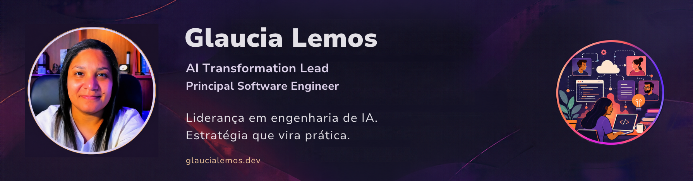

## Hi, Coders! I'm Glaucia 👋

**AI Transformation Lead · Software Engineer · Open-source Contributor · Microsoft MVP · Codex Ambassador · Devin Ambassador**

I'm an AI Transformation Lead and Software Engineer based in Rio de Janeiro, Brazil. I work across product problems, software architecture, and AI systems—helping teams turn ideas into implementations they can understand, evaluate, and maintain.

My work combines hands-on engineering with technical leadership, drawing on more than a decade of software development and developer education. I focus on the decisions behind a solution: how its parts fit together, where AI adds value, and how to verify that the result meets the need.

In my current role at a major Latin American bank, I work across teams and the engineering organization to help deliver AI-enabled initiatives used in production. That means aligning product, architecture, quality assurance, and engineering—not treating AI adoption as an isolated tooling decision.

For me, adopting AI is not just choosing a model or generating code faster. It means working across product, design, architecture, engineering, and quality to decide **what to build, what context an agent needs, and how to verify the result**. I care about the trade-offs: quality versus speed, capability versus cost, and automation versus human judgment.

## Book

I'm co-author, with Salim Laimeche, of **[Building Agentic AI Apps with Next.js and TypeScript](https://www.packtpub.com/en-us/product/building-agentic-ai-apps-with-nextjs-and-typescript-9781806700936)**, forthcoming from Packt. The book explores RAG, MCP, context engineering, and multi-agent workflows in full-stack AI applications.

**Available for pre-order.** See Packt's listing for the current publication schedule.

## What I'm working on

- **AI across the development lifecycle:** turning requirements into specifications, small implementation slices, tests, and reviewable changes.
- **Context and harness engineering:** giving coding agents useful instructions, tools, feedback, and verification—not just longer prompts.
- **AI applications and integrations:** retrieval-augmented generation (RAG), LangChain.js, MCP integrations, and agent-based developer tools.
- **Practical education:** workshops, technical mentoring, talks, and open-source learning materials that explain the reasoning behind the code.

## Selected projects

These public repositories show different parts of that work. The trade-offs below are questions worth exploring in each project—not claims of benchmarked results.

### [RepoCheckAI](https://github.com/glaucia86/repocheckai)

**Problem:** understanding the health of a GitHub repository and deciding what needs attention first.  
**Approach:** an AI-powered analyzer built with the GitHub Copilot SDK, with a quick GitHub API scan and a deeper source-analysis mode.  
**Trade-off to explore:** a bounded scan keeps the investigation focused; deeper analysis brings more context to inspect and validate. AI findings still need engineering judgment.

### [RAG Search Ingestion](https://github.com/glaucia86/rag-search-ingestion-langchainjs-gemini)

**Problem:** answering questions using the contents of PDF documents.  
**Approach:** TypeScript and LangChain.js for ingestion and retrieval, Gemini for embeddings and generation, and PostgreSQL with pgvector for vector storage.  
**Trade-off to explore:** chunking and retrieval choices determine what evidence reaches the model. More context is not automatically better context, and a fluent answer is not proof of correctness.

### [Weather MCP Server](https://github.com/glaucia86/weather-mcp-server)

**Problem:** connecting an AI assistant to weather information outside its training data.  
**Approach:** a TypeScript MCP server with OpenWeatherMap integration, PostgreSQL, Redis, and Docker, organized around Clean Architecture.  
**Trade-off to explore:** caching can reduce repeated upstream requests, but freshness matters; architectural boundaries help isolate integrations while adding structure to maintain.

### [AI with JavaScript — learning materials](https://github.com/glaucia86/ai-js-course)

**Problem:** making AI application development approachable for JavaScript developers.  
**Approach:** a structured curriculum that includes Azure OpenAI and speech-to-text with Whisper, from model fundamentals to TypeScript integration.  
**Trade-off to explore:** a working API call is only the beginning; transcription quality, audio handling, and service constraints also need attention.

## Open source & my Microsoft chapter

Open source is a central part of how I learn, build, and teach. Before my current work in AI transformation, I was a Developer Advocate at Microsoft, working with JavaScript, TypeScript, cloud applications, and AI. That chapter remains part of my engineering background:

- **[Serverless AI Chat with RAG](https://github.com/Azure-Samples/serverless-chat-langchainjs):** contributions to a document-grounded chat sample using LangChain.js, Azure Functions, and Cosmos DB, including [response streaming](https://github.com/Azure-Samples/serverless-chat-langchainjs/commit/12b6e137bb835d2e4fc5147b115d1b783827e79a) and [step-by-step learning materials](https://github.com/Azure-Samples/serverless-chat-langchainjs/commit/0af3f35c9e6e378229867d62c248fa2a1645de0b). A practical setting for exploring local inference with Ollama versus managed Azure services, retrieval quality, and deployment complexity.
- **[Microblog AI](https://github.com/Azure-Samples/microblog-ai-remix):** my work on an AI-assisted microblogging sample with Remix and Azure OpenAI, including [migration work from Static Web Apps to Container Apps](https://github.com/Azure-Samples/microblog-ai-remix/commit/551544ae13e5b1e5208ff95098ccb4d4f2a174c3). A useful example for discussing rendering, hosting, and deployment choices—not just calling a model.
- **[Contoso Real Estate](https://github.com/Azure-Samples/contoso-real-estate):** contributions to a composable JavaScript reference application, alongside [live sessions explaining the project and open-source contribution](https://developer.microsoft.com/en-us/reactor/events/20288/). **Now archived:** included here as part of my contribution history, not as an actively maintained deployment template.
- **[Generative AI for Beginners](https://github.com/microsoft/generative-ai-for-beginners):** contributions to open learning material, including [function-calling examples](https://github.com/microsoft/generative-ai-for-beginners/commit/6cb707f35bbfe2317e7580e0f67339bdea3adf85).

My community background also includes Node.js and React localization, technical writing, and live coding. I care about making technical knowledge accessible and helping more people take part in open source.

## Community, workshops & teaching

I'm a **Microsoft MVP**, **[Codex Ambassador](https://developers.openai.com/community/codex-ambassadors/directory)**, and **Devin Ambassador** based in Rio de Janeiro. I organize workshops and meetups that bring the local software and AI communities together to learn, build, and exchange practical experiences.

Recent examples include the **[Codex Community Meetup — Rio de Janeiro](https://luma.com/4hudcuqo)** and **[DevDay Exchange Community — Rio de Janeiro](https://luma.com/wzk8q92k)**. I also share [hands-on event materials](https://github.com/glaucia86/devday-exchange-community-rio-2026) so that learning can continue after the meetup.

I create content in Portuguese and English. Whether I'm teaching TypeScript, exploring RAG, or working through a change with a coding agent, I want people to understand what is happening under the hood, question the output, and build with confidence.

**Interested in a workshop, technical mentoring, or a talk?** Explore [my website](https://glaucialemos.dev) or [connect with me on LinkedIn](https://www.linkedin.com/in/glaucialemos/).

## 💻 Technologies & Tools

Tools I use across public projects, learning materials, and engineering work—not a list of certifications.

**AI applications & developer tooling**

**Application engineering**

**Data & retrieval**

**Cloud providers & containers**

**Testing & delivery**

## ⭐ GitHub Stats

## 📺 Latest YouTube Videos
<!-- YOUTUBE:START -->
- [A verdadeira guerra da IA é pelo menor custo?](https://www.youtube.com/shorts/Fjr8Fldb5h8)
- [Graph Engineering? Outro conceito?!](https://www.youtube.com/shorts/PXdrWzHajnY)
- [Build in Public: Melhorias no Repo Doctor com Copilot CLI + Copilot SDK #02](https://www.youtube.com/watch?v=I_TlmQ1T3Ok)
- [Build in Public: Melhorias no Repo Doctor com Copilot CLI + Copilot SDK](https://www.youtube.com/watch?v=7FNu1Tdn6kQ)
- [Copilot SDK na Prática: Criando um Agente de Análise de Repos](https://www.youtube.com/watch?v=6mh_LETKLaU)
<!-- YOUTUBE:END -->

## 📕 Latest Blog Posts

<!-- BLOG-POST-LIST:START -->
- [Construí um Agentic CLI Tool com IA usando o Copilot SDK — Conheça o Repo Doctor!](https://dev.to/glaucia86/github-copilot-sdk-construindo-aplicacoes-agenticas-com-ia-na-pratica-com-repo-doctor-25a6)
- [Repo Doctor - AI-powered GitHub Repository Health Analyzer](https://dev.to/glaucia86/repo-doctor-ai-powered-github-repository-health-analyzer-136n)
- [StackSpot AI: Transforme Seu Fluxo de Desenvolvimento com Agentes Inteligentes](https://dev.to/glaucia86/stackspot-ai-transforme-seu-fluxo-de-desenvolvimento-com-agentes-inteligentes-56lo)
- [Close Those 20 Browser Tabs: How MCP Servers Bring Documentation into VS Code](https://dev.to/glaucia86/close-those-20-browser-tabs-how-mcp-servers-bring-documentation-into-vs-code-435f)
- [From Zero to MCP: Building a Model Context Protocol Server with TypeScript and the Star Wars API](https://dev.to/glaucia86/from-zero-to-mcp-building-a-model-context-protocol-server-with-typescript-and-the-star-wars-api-1kdi)
<!-- BLOG-POST-LIST:END -->

## 🎯 Let's Keep in Touch

## 🔴 I do some Live Codings! So follow me also on...

